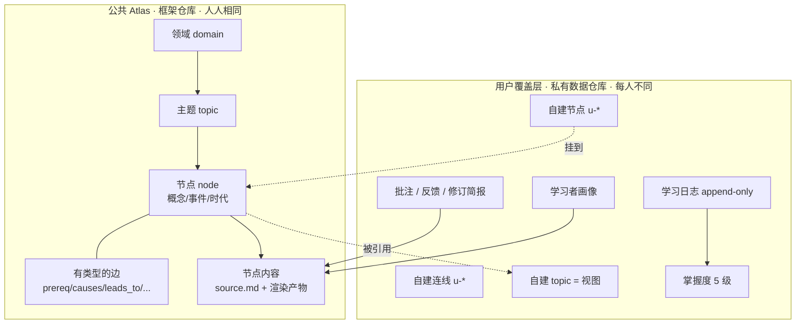
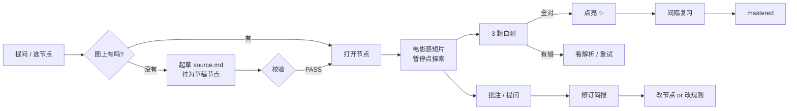
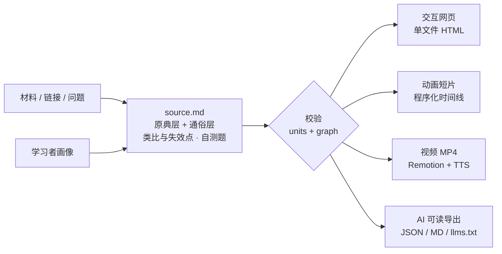
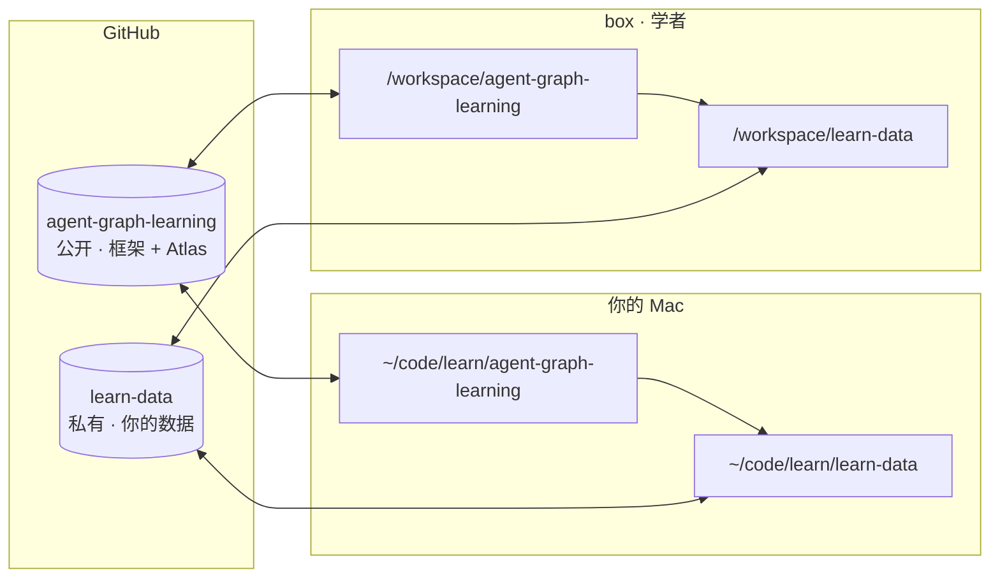
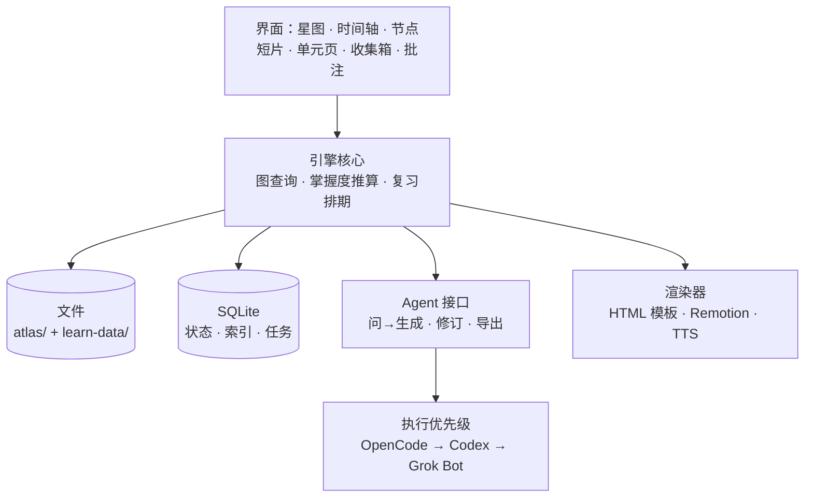

```metrics
2 | 层：产品框架（开源）+ 个人数据（私有）
1 | 张全局知识大图，topic 只是视图
5 | 级掌握度，不显示百分比
4 | 个里程碑 M0–M3，M0 = 加载全人类地图 + 点亮
```

::: summary 结论先行
- **定位变了**：从「只给 focus 一个人用的学习 OS」变成「**人人可用的知识地图学习框架**」，focus 是第一个用户、也是调教者。
- **两层分开**：① 产品框架 = 引擎 + 应用 + 一张可公开的「全人类知识地图（Atlas）」；② 个人数据 = 你的画像、进度、学习日志、批注反馈、你自己建的 topic 和连线、私人单元。框架开源，数据放私有仓库。
- **仓库建议**：把 `Lichangfocus/agent-graph-learning` 演进成公开框架仓库，吸收 box 上的 `scholar-engine`；新建私有仓库 `Lichangfocus/learn-data` 放你的数据。两个仓库在 box 和你的 Mac 上各 clone 一份，通过 GitHub 同步。
- **第一个里程碑 M0**：在新框架里加载整张人类知识地图骨架（约 10 个领域），先点亮历史的 11 个节点，Mac 和 box 都能跑起来。
- **都还没动**：没有建仓库、没有推送 agent-graph-learning、没有改名，等你确认。
:::

::: section 定位与用户

**一句话**：把任何知识放到同一张「人类知识大图」上，用电影感的方式讲懂，学会一个就点亮一颗星；每个人的地图骨架相同，但走过的路、留下的反馈和长出来的连线各不相同。

| 用户 | 阶段 | 他要什么 | 产品给什么 |
|---|---|---|---|
| **focus（第一个用户）** | 现在 | 季度主题持续学（Q4 通史 → 语言学 → …）；在任何 bot 里说「通俗讲解」都能接上；本地 Mac 调试 | 全量功能 + 私有数据仓库 + 和引擎一起调教 |
| **自学的成人** | M3 起 | 按自己的需求建地图、学到哪算哪 | 公开的 Atlas + 自建 topic + 本地存储（可选云同步） |
| **家长 / 孩子** | 已有雏形 | 按理解关系学、像多邻国一样有反馈 | 沿用 agent-graph-learning 已有的「声音之旅」这类儿童地图和硬锁模式 |
| **其他 agent / bot** | 现在 | 拿到可读的知识结构当上下文 | 每个节点都有 Markdown / JSON / `llms.txt` 导出，加上「通俗讲解」技能 |

**和 v0.2 相比的变化**：v0.2 写的是「不做多用户、不要账号、不对外发布」。v0.3 改为**框架对外、数据不出私有仓库**。默认仍然本地优先、不要账号；云同步只作为别人部署时的可选项。
:::

::: section 核心概念



| 概念 | 定义 | 关键规则 |
|---|---|---|
| **Atlas（全人类知识地图）** | 框架自带的规范大图：领域 → 主题 → 节点，加边 | 节点全局唯一 id；按 semver 发版；改名或合并节点时写 id 迁移表，用户数据不断链 |
| **用户覆盖层（overlay）** | 每个人在 Atlas 上叠加的东西 | **只引用、不改写** Atlas；自建节点和边的 id 以 `u-` 开头；可以把一个自建节点「提议」进 Atlas（走 PR） |
| **Topic = 视图** | 从大图里截取的一组节点（Heptabase 式），可以带布局坐标 | 同一个节点可以出现在多个 topic 里，不复制。所以 topic 之间天然相通 |
| **节点（node）** | 类型：`domain` / `topic` / `concept` / `event` / `era`；时间范围（负数为公元前）、地理、摘要、内容路径 | 状态有 `stub`（只有一句话）→ `draft` → `ready`，「问 → 生成」就是把 stub 变成 ready |
| **有类型的边** | `prereq` 建议先学 · `belongs` 属于 · `causes` 导致 · `leads_to` 铺垫 · `contrast` 对照 · `related` 相关 · `parallel` 同期 | 每条边带 `note`（为什么连）和 `claim_type`（事实 / 学界共识 / 主流解释 / 有争议 / AI推断） |
| **掌握度 5 级** | `locked` 前置未亮（半透明但能打开）→ `seen` 看过 → `learning` 学了一半 → `lit` 自测全对 → `mastered` 间隔复习通过 | 只显示等级和点亮个数，**不显示百分比**；锁定方式可设置：成人默认软提示，儿童地图可用硬锁 |
| **学习日志** | 追加写入的事件流：`open / play / quiz / lit / review / note / ask / topic_create / link_create` | **掌握度由日志推算**，不单独存状态。这样多台设备同时写也不冲突 |
| **反馈 → 修订** | 批注四类意图（要改 / 有疑问 / 认可 / 补资料）+ 错答 + 复述 + 提问，汇成《修订简报》 | 每条修订先判断是「只改这个节点」还是「改规则（画像 / 提示词 / schema）」，改规则才会越用越像老师 |
| **双层知识** | 每个节点有原典层（canon：术语、正式表述、出处）和通俗层 | 来自 agent-graph-learning，保留「📖 原典怎么说」切换 |
:::

::: section 核心功能与用户流程

**六个核心功能**

1. **建图**：选一个领域或 topic 起步；可以从 Atlas 里挑节点组成自己的 topic，也可以描述需求（比如「我想理解大模型训练」），让 agent 在 Atlas 上圈出相关节点、补缺失节点并连边。新建的部分进你的覆盖层，经过校验才显示。
2. **问 → 生成节点**：在任何地方（包括其他 bot 里的「通俗讲解」）提一个问题，agent 先判断它落在图的哪里：已有节点就打开它，没有就起草 `source.md`，作为 stub 或草稿挂到最近的节点旁边。
3. **电影感学习**：节点打开后像一部短片一样自动往下播：片头 → 时间缩放 → 地图动画 → 驱动力（能量 / 信息 / 组织）→ 关键事实 → 东西对照 → 解释框架（标明「非定论」）→ 为下一步铺了什么 → 自测。中间有暂停点，可以停下来自己探索。
4. **点亮**：3 道自测全对就点亮，星图上那颗星会亮起来，并提示新解锁了哪些节点。
5. **复习**：点亮后按间隔复习排期（比如 1 / 3 / 7 / 21 天），复习通过就升到 `mastered`。
6. **跨 topic 连线**：在两个节点之间画一条边，选类型并写一句为什么。这条边对所有包含这两个节点的 topic 都可见。



**一个周末的使用场景（focus）**：在 Mac 上打开星图 → 历史领域里亮着 s1、s2 → 点 s3「城市、国家与文字」→ 看 45 秒短片，在地图那一幕暂停看两河流域 → 跳到「文字系统」（语言领域的节点，同一张图上）→ 做自测、点亮 → 留一条「有疑问」批注 → 关掉。学习日志写进 `learn-data`，box 上的学者下次就能读到，并据此改内容。
:::

::: section 内容管线

沿用 scholar-engine 已经跑通的「一源多渲染」：每个节点只有一份 `source.md`，所有形态都从它生成，修订也只改它。



| 环节 | 现在 | 下一步 |
|---|---|---|
| 材料 → `source.md` | `npm run explain` 快速通道；初稿由 agent 写（执行优先级：OpenCode → Codex → 自己） | 起草步骤接上 OpenCode 自动跑 |
| 校验 | units + graph 校验器（来自两个项目的规则合并） | 加 Atlas 校验：id 唯一、边类型、claim_type 必填、迁移表 |
| 交互网页 | U01/U02 单元页、讲解单页、知识地图 v0.1 单文件 | 统一成一个模板族：星图 / 时间轴 / 节点短片 / 单元页 |
| 动画 | 地图 v0.1 用手写补间引擎，`render(t)` 是 t 的纯函数，能拖进度 | 同一份节点 JSON 复用给视频 |
| 视频 | ffmpeg 出带字幕的静音视频 | Remotion 批量渲染 + TTS 配音（M2） |
| AI 导出 | `units.json`、`units-md/`、`llms.txt` | 每个 Atlas 节点都有导出；其他 bot 用「通俗讲解」技能读取 |
:::

::: section 框架与数据分离

**原则**：框架仓库里不出现任何你个人的东西；数据仓库里不放代码，只放能被框架读的数据包（user pack）。框架没有数据包也能跑，会加载示例数据包。



**框架仓库布局（建议）**

```text
agent-graph-learning/            公开 · 代码 MIT，Atlas 内容 CC BY-SA 4.0（待定）
├── apps/web/                    Next.js：本地 dev、编辑和调试（来自 scholar-engine/app）
├── apps/desktop/                Tauri 2 外壳（M3）
├── engine/
│   ├── schema/                  zod + JSON Schema：unit / node / edge / topic / userpack
│   ├── pipeline/                validate · explain · exports · preview · map · video
│   └── templates/               单文件 HTML 模板：星图、时间轴、节点短片、单元页、讲解页
├── atlas/                       全人类知识地图
│   ├── domains/*.json  nodes/*.json  edges/*.json
│   ├── content/<node-id>/source.md   公开节点的讲解内容
│   └── migrations/              id 改名 / 合并的迁移表
├── skills/                      learn-map、通俗讲解（给 agent 用）
├── examples/demo-pack/          示例数据包（没有个人数据时加载它）
├── maps/                        已有的 ai-training、sound-journey，原路径保留，Pages 链接不断
└── docs/
```

**数据仓库布局（`learn-data`，私有）**

```text
learn-data/
├── pack.json                    {schema:"learn.userpack.v1", owner, atlas_version, engine_version}
├── profile/learner-profile.yaml 学习者画像（从 scholar-engine/profile 迁来）
├── overlay/
│   ├── nodes.jsonl              自建节点 u-*
│   ├── edges.jsonl              自建连线 u-*
│   └── topics/<id>.yaml         自建 topic（成员 + 布局）
├── log/<device>/YYYY-MM.jsonl   学习日志，每台设备一个目录，只追加
├── notes/<device>/*.jsonl       批注
├── revisions/                   修订简报 + 处理结果
├── units/<id>/source.md         私人单元（含版权图片的、只给自己的）
├── curriculum/                  季度课表（course-q4-2026 等）
└── .gitignore                   media/、缓存、派生的 mastery.json
```

**几条规则**

- **导入导出**：数据包本身就是导出格式。单文件 HTML 里的进度存在 localStorage，可以导出成同一 schema 的 JSON，再导入任何设备；dev 服务器模式下直接读写 `learn-data/` 里的文件。
- **不冲突**：日志按设备分文件、只追加；掌握度从日志推算，不提交，不会两边改同一行。
- **隐私**：画像、日志、批注、私人单元只在私有仓库；框架仓库的 CI 加一条检查，禁止出现 `profile/`、`log/` 这类路径。agent-graph-learning 里已有的 Supabase 匿名 key 是公开安全的（靠行级安全策略），只给其他用户做可选云同步，你自己用 git 同步。
- **Atlas 和用户层的关系**：用户层只引用 Atlas 的 id；Atlas 升级时按迁移表重写引用；你自建的节点如果有普遍价值，可以提议进 Atlas，走 PR。
:::

::: section 技术架构

| 阶段 | 形态 | 存储 | 说明 |
|---|---|---|---|
| **现在 → M1** | 单文件 HTML（双击打开）+ Next.js dev 服务器 | localStorage + 导出 JSON；dev 模式读写 `learn-data/` | 零依赖、file:// 可用，和现有产物兼容 |
| **M2** | 同上 + Remotion 视频管线 | 同上；视频进 `media/`（不进 git，或用 LFS） | 同一份节点 JSON 驱动动画和视频 |
| **M3** | Tauri 2 桌面应用（Mac 优先） | SQLite：node / edge / topic / topic_node / mastery / event_log / asset / source | 内容仍以文件为真源，SQLite 只存状态和索引；数据包 JSON 作为迁移格式 |



**技术选择的说明**：ADR-0001 当时选的是 Electron；调研后建议改用 Tauri 2，体积小、省内存，Mac 体验更好。这需要你确认，确认后写 ADR-0002。
:::

::: section 仓库方案对比

| 方案 | 做法 | 好处 | 代价 |
|---|---|---|---|
| **A（建议）** | `agent-graph-learning` 演进为公开框架，吸收 scholar-engine；新建私有 `learn-data` | 已经公开、MIT、开着 Pages；品牌「Agent 图谱学习法」和方法论（双层知识、顺序重构、校验器、可行性盲测）就是这个产品的底子；已有 60 节点教材当示例 | 技术栈要合并（它是零依赖单 HTML，scholar-engine 是 Next.js + TS），需要一次结构调整；README 定位要从「孩子」扩到「所有人」 |
| B | 新建公开框架仓库（如 `learn`），agent-graph-learning 冻结成「方法论 v1」 | 起点干净，没有历史包袱 | 两个公开仓库分散 star 和链接；方法论和代码分家 |
| C | 只把 scholar-engine 推成私有仓库，框架和数据先不分 | 最快 | 违背「框架开源、数据私有」的要求，以后还得拆一次 |

**方案 A 的迁移步骤**（都走 PR，只有你合入 `main`，按《本地 + 云端双端开发范式 v1》）：

1. 分支 `cloud/grok/TASK-001-merge-engine`：把 scholar-engine 的 `app/ pipeline/ src/ schema/ tests/` 迁到 `apps/web` 和 `engine/`；把 `knowledge/world-map.json` 拆进 `atlas/`；`maps/` 原路径保留。
2. 同一批：`profile/`、`course-q4-2026.md`、`curriculum/`、U01/U02 这类带作品图片的单元，**不进**框架仓库，迁到 `learn-data`。
3. 框架仓库加 CI：`npm run check` + 隐私路径检查。
4. scholar-engine 在 box 上保留为只读归档，等迁移验收后再决定是否删除（需要你确认）。
:::

::: section Mac + box 同步与本地调试

**目录约定**：两台机器上两个仓库都放在同一个父目录下，彼此是兄弟目录。

```bash
# 你的 Mac（一次性）
mkdir -p ~/code/learn && cd ~/code/learn
gh repo clone Lichangfocus/agent-graph-learning
gh repo clone Lichangfocus/learn-data
cd agent-graph-learning && npm i

# 本地调试：dev 服务器，读写 ../learn-data
LEARN_DATA_DIR=../learn-data npm run dev     # 打开 http://localhost:43123

# 或者只看单文件：构建后双击
npm run map:build && open out/map.html

# 日常同步
git -C ~/code/learn/agent-graph-learning pull
git -C ~/code/learn/learn-data pull --rebase && git -C ~/code/learn/learn-data push
```

box 上是同样的布局：`/workspace/agent-graph-learning` + `/workspace/learn-data`。

| 仓库 | 谁写 | 怎么合入 |
|---|---|---|
| 框架 `agent-graph-learning` | 你（`local/*` 分支）、学者和其他 worker（`cloud/<worker>/*` 分支） | PR → **只有你合入 main**；涉及界面的 PR 打 `needs-mac`，你在 Mac 上 `gh pr checkout` 验收 |
| 数据 `learn-data` | 你的 Mac（学习日志）、学者（生成内容、修订） | 建议允许**直接推 main**：日志只追加、按设备分文件，几乎不会冲突；推之前先 `pull --rebase` |
:::

::: section 里程碑

| 里程碑 | 目标 | 内容 | 完成标志 |
|---|---|---|---|
| **M0 地图上线**（建议 10-19 → 10-25） | 加载整张人类知识地图，开始点亮 | 你确认后建 `learn-data` 并完成仓库迁移；Atlas v0.1：约 10 个领域、每个领域 2–4 个 topic、一批 stub 节点，历史 11 个节点完整（短片 + 3 题自测）；星图 + 对数时间轴；点亮写进日志 | 你在 Mac 上打开星图，点亮 s1，提交到 `learn-data`，box 上能读到同一条记录 |
| **M1 建图** | 自己建图、问 → 生成节点 | 新建 topic、跨 topic 连线、「问 → 生成」挂草稿节点；dev 服务器直接写数据仓库；通史 W0+W1 合并单元上线 | 用你发来的文章生成一个节点并挂到图上；连续两个周末用它上课 |
| **M2 电影感 + 闭环** | 有声短片、复习、调教闭环 | Remotion + TTS 配音视频；间隔复习 → mastered；批注 → 修订简报 → 改节点或规则；Atlas 扩到上百个 ready 节点 | 历史 11 节点都有配音短片；有一次「改规则」的修订被验证有效 |
| **M3 桌面版 + 开放** | Tauri 桌面应用，别人也能用 | Tauri 2 + SQLite；新用户引导：选需求 → 生成自己的地图；Atlas 公开发版；可选云同步 | 2027 Q1 语言学在桌面应用里上课；一个外部用户从零建出自己的地图 |
:::

::: section 需要你决定的问题

1. **仓库方案**：同意方案 A 吗？也就是把 `agent-graph-learning` 改造成框架仓库（目录会调整，README 定位从孩子扩到所有人，`maps/` 原路径保留）。
2. **数据仓库**：新建私有仓库叫 `Lichangfocus/learn-data` 可以吗？学者能不能直接推它的 `main`？
3. **Atlas 是否现在公开、用什么许可**：建议代码 MIT、Atlas 内容 CC BY-SA 4.0；或者 Atlas 先私有，稳定后再公开。
4. **产品名**：对外叫「Agent 图谱学习法」、「学者」，还是另起一个？
5. **锁定方式**：成人默认软提示（前置没点亮也能打开），儿童地图保留硬锁，可以吗？
6. **桌面外壳**：从 Electron 改成 Tauri 2，可以吗？
7. **云同步**：你自己只用 git 同步；Supabase 云同步只留给别人部署时选用，可以吗？
8. **Mac 路径和环境**：`~/code/learn/` 可以吗？Mac 上的 Node 版本是多少？（需要 ≥ 20）
9. **scholar-engine 的去留**：迁移验收后，box 上的 scholar-engine 是归档保留还是删除？
10. **版权**：带名画图片的单元（U01/U02）只放私有仓库，不进公开 Atlas，可以吗？
:::
