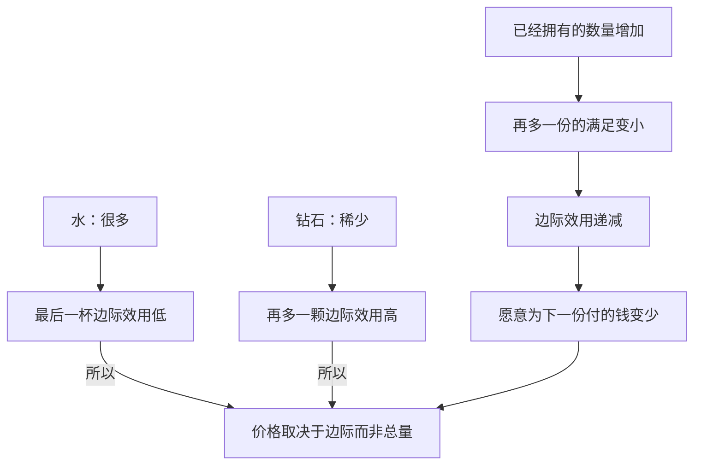

## Essence
决定你愿意付多少钱的，不是一样东西"总共"多有用，而是"再多一份"给你带来多少额外好处。

## Hook Question
水能救命，钻石不能——可为什么一瓶水两块钱，一克拉钻石要几万？先猜：问题出在"有用"这个词的哪里？

## Core Narrative
**结论先行：价格看的是"最后一份"的用处，不是"整体"的用处。** 经济学把"再多消费一单位带来的额外满足"叫**边际效用**。"边际"就是"在边上、再加一点"的意思。【主张：学界共识；新古典经济学基础概念。】

**边际效用通常递减。** 饿的时候第一个包子特别香，第二个还不错，第五个可能已经吃不下——每多一个，新增的满足越来越少，甚至变成负的（撑着难受）。这叫**边际效用递减**。【主张：共识，作为经验规律成立；存在例外，如收藏凑套、上瘾品的短期反应。】

**水和钻石悖论就这样解开。** 水的**总效用**极大（没水会死），但水很多，你手里"再多一杯"几乎不带来新好处，所以它的边际效用很低、价格很低；钻石稀少，再多一颗的边际效用（以及它作为稀缺信号的作用）很高，所以贵。在沙漠里迷路时，这个排序会反过来。【主张：共识；"钻石价格也受垄断与营销影响"属另外的事实层，不影响本概念。】

**对你有用的推论：** 做决策时别问"这东西整体好不好"，问"在我现在已有的基础上，再加一份值不值"。多招一个人、多加一个功能、多读一本同类书，都是边际问题。【主张：AI 推断/迁移，供你检验。】

## Key Concepts
```yaml
- term: 边际效用
  explanation: 在已有数量的基础上，再多得到一单位东西，额外增加的满足感。
  analogy: 像给手机加内存：从 4G 加到 8G 体感明显，从 64G 加到 68G 几乎无感——同样是"加 4G"，价值取决于你已经有多少。
  analogyLimit: 内存的收益能用跑分测量；效用是主观的，没法直接测，经济学只能从人们"愿意付多少钱、怎么选"反推出来。
- term: 边际效用递减
  explanation: 通常情况下，同一样东西拥有得越多，再多一份带来的额外满足越小。
  analogy: 像给模型加训练数据：前一万条提升巨大，后面每加一万条提升越来越小。
  analogyLimit: 数据的递减有时会被"质变"打破（新能力涌现）；人对多数商品没有这种跳变，但收藏凑齐一套、网络效应产品会出现边际效用先升后降。
- term: 总效用 vs 边际效用
  explanation: 总效用是全部数量加起来的满足；边际效用是最后那一份的满足。价格主要跟后者挂钩。
  analogy: 像一个团队的总产出和"再招一个人"的增量产出：团队整体很重要，不代表第 50 个人同样重要。
  analogyLimit: 团队成员彼此不同，而经济学讨论边际效用时假设每一份商品是一样的（第一杯水和第十杯水是同样的水）。
```

## Example
```yaml
title: 吃包子的账本
body: |
  假设你中午很饿，给每个包子带来的满足打分：第 1 个 10 分，第 2 个 7 分，第 3 个 4 分，第 4 个 1 分，第 5 个 -2 分（撑了）。
  总效用：吃 4 个时最高，10+7+4+1 = 22 分；吃第 5 个反而降到 20 分。
  如果包子 3 块钱一个，而你觉得"3 分满足 ≈ 值 3 块钱"，你会吃到第 3 个就停——因为第 4 个只带来 1 分，不值 3 块。你停下的位置，就是"边际效用 = 价格"的地方。
```

## Diagram


## Misconceptions
```yaml
- myth: 越有用的东西就越贵。
  truth: 价格跟"再多一份"的用处挂钩，不跟"整体有多重要"挂钩——水就是反例。
- myth: 边际效用递减说明多了就不好。
  truth: 递减说的是"新增的好处变小"，只要还是正的，总效用仍在上升；只有边际效用变成负的，多了才真的变差。
- myth: 效用可以用一个精确的数测出来。
  truth: 例子里的分数只是为了讲解；现实中效用是主观的，经济学通过人的选择和支付意愿来间接推断。
```

## Check Yourself
```yaml
- id: q1
  question: "水比钻石有用，却便宜得多。最好的解释是？"
  answer: "价格由边际效用决定：水多，最后一杯的额外好处很低；钻石稀少，再多一颗的额外好处高。"
  options:
    - text: "水的总效用大，但边际效用低；钻石稀少，边际效用高"
      correct: true
      why: "对。价格看的是最后一份的价值。"
    - text: "钻石其实比水更有用"
      why: "不对。没有钻石能活，没有水不能活，水的总效用更大。"
    - text: "因为水不需要生产成本"
      why: "不对。供水也有成本；而且这无法解释沙漠里水会变贵。"
  hint: "区分\"总共有多有用\"和\"再多一份有多有用\"。"
- id: q2
  question: "你已经吃了 3 个包子，第 4 个仍然让你更满足一点点。此时说法正确的是？"
  answer: "边际效用为正但在变小，总效用还在增加。"
  options:
    - text: "边际效用为正但在递减，总效用仍在上升"
      correct: true
      why: "对。递减不等于变差，只要还是正的，总量就在涨。"
    - text: "边际效用递减了，所以总效用开始下降"
      why: "不对。只有边际效用变成负数，总效用才下降。"
    - text: "第 4 个包子的边际效用比第 1 个更高"
      why: "不对。这与\"递减\"相反。"
  hint: "总量什么时候才会下降？"
- id: q3
  question: "（迁移）产品已有 30 个功能，团队在争论要不要加第 31 个。用边际思维该问什么？"
  answer: "问在现有 30 个功能的基础上，第 31 个给用户带来的额外价值是否大于它的成本（开发、复杂度）。"
  options:
    - text: "第 31 个功能在现有基础上带来的额外价值，是否大于它的额外成本"
      correct: true
      why: "对。这正是\"边际收益 vs 边际成本\"的比较。"
    - text: "这个功能本身重不重要"
      why: "不对。这问的是总效用，忽略了已有功能可能已经覆盖它的价值。"
    - text: "竞品有没有这个功能"
      why: "不对。可作参考，但不是边际判断本身。"
  hint: "关键词是\"在已有基础上再加一个\"。"
```

## Missing
原文只讲了直觉与水钻石悖论，没有涉及：效用能否测量（基数 vs 序数效用）、边际效用与需求曲线的推导、钻石价格中的垄断与营销因素。如果想深入，可以补一章教材（如曼昆《经济学原理》第 21 章"消费者选择理论"）。
