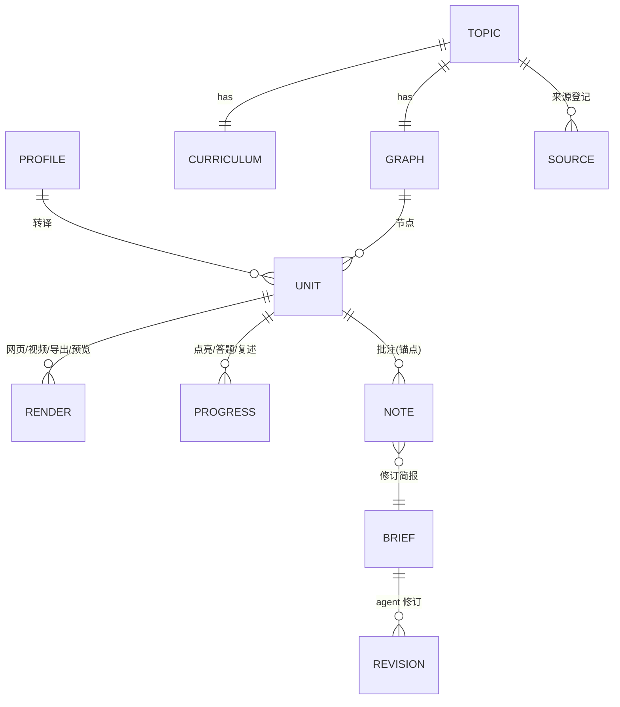
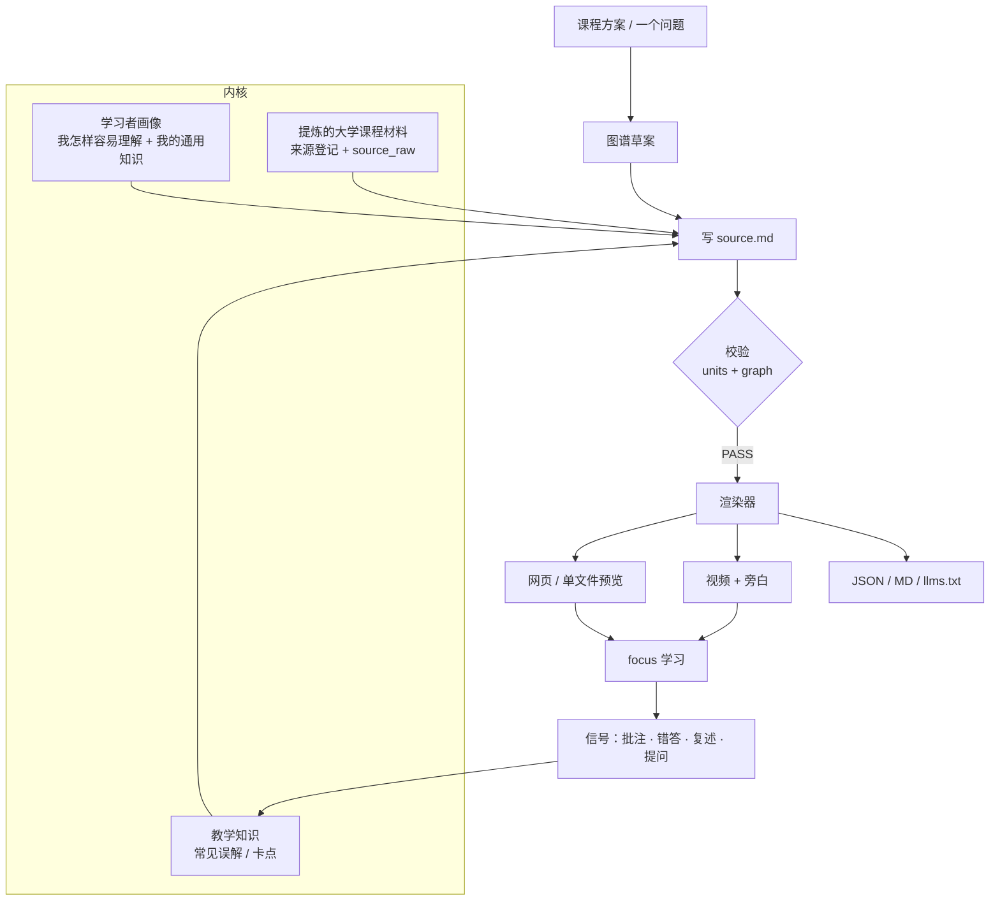
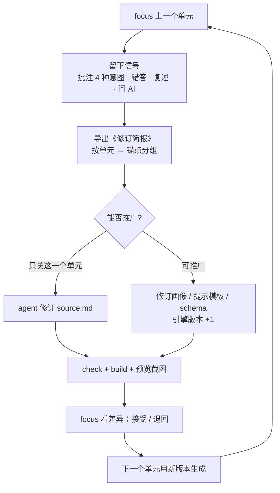

# 产品方案：学者（个人学习 OS）

> v0.2 · 2026-10-07 · 人生-学者 起草，待 focus 确认
> 方向和原则见 [产品方向](product-direction.md)。外壳决策见 [ADR-0001](adr/0001-electron-shell.md)。

## 结论先行

- **Q4 照常开学，不等 Electron。** 引擎已经能用文件加单文件预览上课，2026 Q4（10-10 → 12-27）边学边调教。
- **Electron 外壳在 Q4 期间并行开发**，目标是 2027 Q1 语言学开学时，在桌面应用里上课。
- 接下来的三件事（已按通史 pivot 更新）：
    1. 开学前（10-17 前）：focus 确认通史课表比重与书架；审 `graph-civilization.yaml` 边（或边学边改）。
    2. W0 开课：用通史学习地图 HTML 跑通第一次批注闭环；开始记生产基线。
    3. 按周生成 W1–W10 单元；旁白 / 提问生成单元 / Electron 仍按原路线图并行（交互原语从「人文」扩展为「通史」：时间轴、制度对照、因果链）。

## 0. Q4 topic 变更（2026-10-10）

focus 将 Q4 从「人文艺术 12 单元」改为 **一季一 topic：人类文明通史**（文化 / 宗教与制度 / 生产力革命）。

- 课表与图谱：见 [`topic-q4-2026.md`](topic-q4-2026.md) → `curriculum/q4-civilization-history.md`、`course/graph-civilization.yaml`。
- 旧人文艺术方案与 U01/U02：**冻结保留**；人生助手侧 M1–M6 已 cancelled。
- **本季成功标准不只是学完**，而是跑通一次完整学者闭环（地图上课 → 批注 → 修订简报 → 改单元或改画像/引擎）。
- 开课：下周末北京时间 2026-10-17–18（W0）；本周只做资料与地图。
- Electron 时间表不变：Q4 并行，2027 Q1 语言学在 App 里上课。

---

## 1. 现状（2026-10-07，如实）

| 能力 | 状态 | 说明 |
|---|---|---|
| 单元规范源 + 校验 | ✅ 已有 | `units/<id>/source.md` → zod 校验。新增了原典层、类比边界、掌握证据、单选题 |
| 真实单元 | 🟡 只有 U01 | U01《看见是一种建构》可学。`demo-hokusai` 是演示单元，U02–U12 都还是 planned |
| 课程知识图谱 | 🟡 草案 | `course/graph.yaml`：12 个节点、17 条边，**边是 AI 推断，待 focus 审** |
| 网页渲染（Next.js 静态导出） | ✅ 已有 | 有知识地图、单元页、自测点亮、问 AI 提示词、进度导入导出 |
| 单文件预览 | ✅ 已有 | `out-preview/index.html`：双击打开。批注可导出《修订简报》 |
| 机器可读导出 | ✅ 已有 | `units.json`、`units-md/*.md`、`graph.json`、`llms.txt` |
| 视频 | ❌ 无旁白 | `u01.mp4` 长 5 分 30 秒，有画面和字幕，**音轨是静音**。管线会尝试 edge-tts，但本机没装，所以退回了静音 |
| 交互件 | 🟡 部分 | 明度探索、高低频切换、对比滑块、缩放标注、时间轴、先预测再揭晓。缺灭点、裁切构图、墨色浓淡 |
| 提问 → 生成单元 | ❌ 未做 | — |
| Electron 外壳 / 本地库 | ❌ 未做 | 只有 ADR。进度和批注目前存在浏览器 localStorage |
| 带打断的讲解课 | ❌ 未做 | 来自 agent-report 的思路，排在 Electron 阶段 |

## 2. 能力清单（目标形态）

1. **主题和课程**：每季一个主题，包括课程方案、来源登记、知识图谱和单元序列。
2. **持续收集**：链接、讲义、课程页、PDF 放进主题的收集箱。agent 提炼成来源条目和 `source_raw.md`，只收核实过的来源。
3. **后台研读和转译**：agent 读材料加画像，产出 `source.md`。随后校验、渲染出网页、视频、导出和预览。
4. **上课**：地图 → 单元：

    - 视频（≤6 分钟，有旁白）
    - 交互（1–2 个）
    - 嵌入式提问、自测、复述
    - 点亮

5. **提问即入口**：任何一个问题，都可以生成一个草稿单元。它挂到图谱上，标成支线或草稿。
6. **讲解课可打断**：边播边问。问题锚定在当前片段，答完接着讲。
7. **共同调教**：批注（4 种意图）、错答、复述和提问会汇总成《修订简报》，交给 agent 修订。可以推广的经验沉淀为规则。
8. **多形态传播**：同一份源，同时有人能学的形态和 AI 能学的形态。

## 3. 用户旅程（Electron 应用内）

| 旅程 | 步骤 |
|---|---|
| 周末上课 | 打开应用 → 地图上标出"从这里继续" → 看视频 → 做交互（先预测再操作）→ 自测（错了给提示，可以重试）→ ≤200 字复述 → 点亮 → 记一个小产出 |
| 提问生成单元 | 任何页面都能"提一个问题" → agent 判断它落在图谱哪里，起草 `source.md`（草稿）→ 校验、渲染 → 出现在地图的支线上，下次上课可选 |
| 收集 | 把材料拖进主题收集箱 → agent 核实来源、写进登记表、提炼原文 → 提示"可用于 U0x" |
| 调教 | 在段落、概念或题目上批注（要改 / 有疑问 / 认可 / 补资料）→ 导出修订简报 → agent 修订 `source.md` → focus 看差异，接受或退回 → 重新渲染 |
| 讲解课 | 播放旁白讲解 → 随时打断提问 → agent 用当前片段加画像回答（只追问，不直接给答案）→ 继续 |
| 换季 | 新主题 → 找课和教材 → 课程方案 → 图谱（AI 草案）→ focus 确认 → 生成第一个单元 |

## 4. 信息架构与数据模型

**应用导航：** 地图（首页）· 今日 · 收集箱 · 批注与修订 · 画像 · 引擎（版本、任务、日志）

**建议的存储决策（修订 ADR-0001，待确认）：** 内容继续以**文件为真源**（git 仓库就是"图书馆"）。SQLite 只存学习状态、索引和任务。这样内容可以 diff，可以版本化，人和 agent 能直接编辑；渲染器和管线也不用改。

| 实体 | 现在的位置 | 以后的位置 |
|---|---|---|
| 画像 | `profile/learner-profile.yaml` + `.md` | 不变（文件） |
| 主题 / 课程方案 | `course-q4-2026.md` | `topics/<季度>/curriculum.md` |
| 图谱 | `course/graph.yaml` | `topics/<季度>/graph.yaml` |
| 来源登记 | `docs/source-registry.md` | 每个主题一份，外加跨主题汇总 |
| 单元 | `units/<id>/source.md`、`source_raw.md`、`assets.json` | 不变 |
| 学习状态 | localStorage `scholar-engine:progress:v1` | SQLite（保留 JSON 导入导出） |
| 批注 | localStorage `scholar-engine:notes:v1` | SQLite，锚点格式 `u01#check-yourself/q2` 不变 |
| 引擎版本 | git commit | git tag 加 `ENGINE_VERSION`；单元 frontmatter 记录生成它的引擎版本 |

## 5. Agent 内核与管线

- **现有的提示模板**在 `pipeline/prompts/`：`source_to_source_md`、`profile_to_guide`、`unit_to_video`、`curriculum_to_graph`。
- **现有的脚本**有 validate、graph:validate、exports、course、video、preview:build，汇总为 `npm run check`。
- **教学知识的来源**：选择题干扰项要写成真实误解；错答和批注回流后，沉淀为单元级或画像级规则。这一层回应的是"没有教学知识，前端就浅"。
- **交互原语库（人文）**：每个原语 = React 组件 + 参数 schema（写在 `source.md` 的 Interactive Components 里）+ 预览用的原生 JS 版本。原则是一次一个变量、先预测再操作。

    - 已有：明度 / 光与色、高低频、对比滑块、缩放标注、时间轴、先预测再揭晓。
    - 待做：灭点（正好对应 U04 透视）、裁切构图、墨色浓淡。

## 6. 共同调教闭环

- **关键的分流：** 每条修订先判断是"只修这一个单元"，还是"改规则"。只有改规则，系统才会越用越像老师。
- **"现成的老师"的判据（待 focus 定数值）：** 连续几个单元，focus 不需要提"要改"类批注，只剩"有疑问"和"认可"。

## 7. 路线图

| 阶段 | 时间 | 内容 | 完成标志 |
|---|---|---|---|
| 0 引擎成形 | ✅ 2026-10-07 | 引擎迁到本地；U01；图谱草案；合并 agent-graph-learning；单文件预览 | `check` + `build` 通过，预览可双击 |
| 1 边学边调教 | Q4 W1–W12（10-10 → 12-27） | 每周一个单元；每单元走一遍调教闭环；补旁白；做"提问 → 单元"；做交互原语库 v0 | 12 个单元可学，基线数据可比 |
| 2 Electron 外壳 | Q4 内并行，2027 Q1 前可用 | 本地库、地图、单元、收集箱、批注修订、后台任务；之后加讲解课打断 | 2027 Q1 在应用里上语言学 |
| 3 跨学科验证 | 2027 Q1–Q2 | 语言学、计算机基础（理科交互：算子、硬件模拟）；验证画像转译跨学科也成立 | 换学科不重写引擎，只加原语和模板 |
| 4 现成的老师 | 2027 H2 起 | 管理、社会学、通识（历史、生物）；focus 基本只学不调 | 调教判据连续达标 |

**下一批里程碑（按顺序）：**

1. **开学前（10-10 前）**：focus 做三件事：

    - 确认画像，清掉 `conflict_flag`；
    - 审图谱的 17 条边；
    - 在预览里给 U01 做第一轮批注，导出修订简报。
   
    agent 据此修订，完成第一次闭环。

2. **W1–W2**：用 `source_to_source_md` 管线生成 U02《人为何造图像》。从这里开始记录 agent 耗时和 focus 介入次数，作为生产基线。
3. **W2–W3**：视频接上旁白。先在本机装好 TTS，跑通 U01 和 U02（音色由 focus 定）。
4. **W3–W4**：做灭点交互原语，赶在 U04《透视引擎》前；把明度和高低频整理成参数化原语。
5. **W4–W6**：做"提问 → 单元"v0，CLI 先行（输入一个问题 → 草稿 `source.md` + 图谱支线节点 → 校验 → 预览）。
6. **W6 起**：Electron v0 外壳，先做只读的图书馆加批注。开工前请人生-独立开发者评审 ADR 和目录结构。

**开发方式：** 在 box 上通过 Codex CLI 写代码（`codex exec`，gpt-6.1-sol，high），每一步都要 check、build、截图验收，只做本地 commit。专业开发问题（Electron 架构、打包、性能）咨询人生-独立开发者。

## 8. 需要 focus 决定的问题

1. **画像和年度计划**：画像里还留着 `conflict_flag`（10-05 的年度计划写 Q4 = 政治经济学）。按你这次说的时间表（Q4 人文艺术 … 2028 Q1 政治经济学）更新，可以吗？画像整体能不能从"待确认"转为确认？
2. **图谱**：17 条先修 / 跨域边是 AI 推断。你审一遍，还是先边学边改？
3. **Electron 的时机和机器**：Q4 期间并行开发，2027 Q1 可用，可以吗？应用跑在你哪台电脑上？
4. **存储**：同意"文件是真源，SQLite 只存学习状态、索引和任务"吗？这会修订 ADR-0001 里"SQLite 首选"的写法。
5. **旁白**：本地 TTS 还是云端 TTS？音色有偏好吗？讲稿文本交给云服务处理可以接受吗？
6. **提问 → 单元的边界**：限当季主题，还是任何问题都行？生成的单元默认进支线，不打乱主线，可以吗？
7. **调教投入**：每个单元你愿意花多少时间批注？"现成的老师"要不要定一个数值判据？
8. **传播**：单元以后要不要公开？课程材料多为 CC BY-NC-SA，作品图片的许可各不相同。现在先只做私用加机器可读导出吗？
